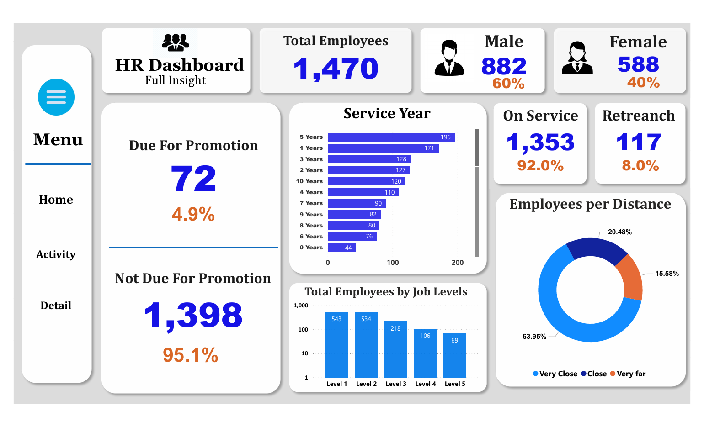
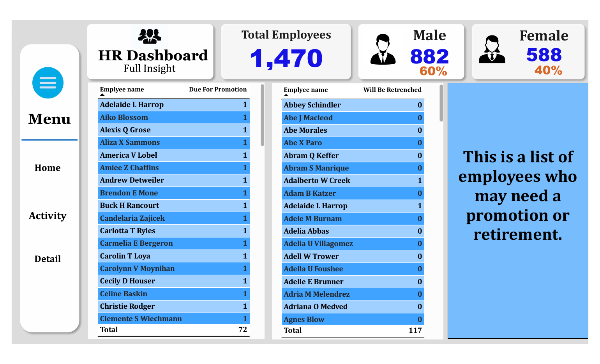
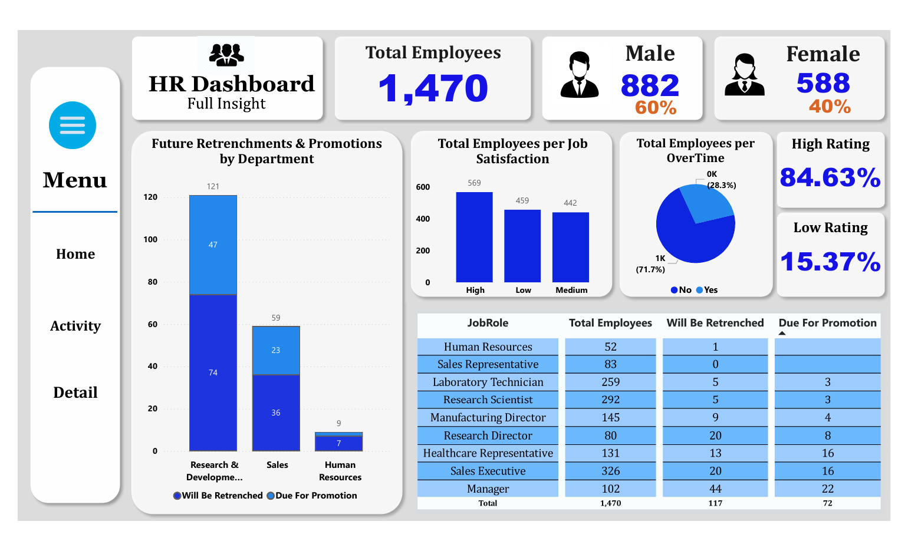

# HR Analytics Dashboard (Power BI)

[](#overview)
[](#dataset)
[](#dashboard)
[](#key-figures)
[](#repository-structure)
[](#authors)

## Overview

An interactive **Power BI** dashboard that gives decision-makers a clear view of a company's workforce: gender distribution, years of service, job levels, job satisfaction, overtime, commuting distance, and the employees due for promotion or retrenchment.

Project report: [docs/project_report.pdf](docs/project_report.pdf)

## Dataset

Two CSV files in the [data](data) folder:

| File | Content |
|---|---|
| `hr_employee_data.csv` | Employee records used by the dashboard |
| `hr_analytics_data.csv` | Additional HR analytics data |

## Dashboard

The report has three pages, reachable from the side menu (**Ctrl + click** on a menu item to navigate).

**Overview**: headcount, gender split, service years, job levels, commuting distance, promotion and retrenchment counts.



**Employee lists**: employees due for promotion and employees who may be retrenched.



**Department and job role analysis**: retrenchments and promotions by department, job satisfaction, overtime, ratings and a job role breakdown.



Features: filtering by department, job level and job satisfaction; bar, pie and donut charts; detailed employee tables.

## Key figures

| Indicator | Value |
|---|---|
| Total employees | 1,470 (882 male, 588 female) |
| On service / retrenchment | 1,353 (92.0%) / 117 (8.0%) |
| Due for promotion | 72 (4.9%) |
| Overtime | 28.3% yes, 71.7% no |
| High / low rating | 84.63% / 15.37% |
| Highest retrenchment count by role | Manager (44) |

## Repository structure

```
power-bi-hr-dashboard/
├── dashboard/
│   ├── hr_dashboard.pbix      # Power BI file (open with Power BI Desktop)
│   └── hr_dashboard.pdf       # PDF export of the report
├── data/
│   ├── hr_employee_data.csv
│   └── hr_analytics_data.csv
├── docs/
│   ├── project_report.pdf
│   └── images/
└── README.md
```

## How to use

1. Install [Power BI Desktop](https://powerbi.microsoft.com/desktop/) (Windows).
2. Open `dashboard/hr_dashboard.pbix`.
3. If Power BI cannot find the data, go to **Home > Transform data > Data source settings** and point the sources to the CSV files in `data/`.

## Authors

Abdessamad Ait Brahim ([@abdessamadaitbrahim](https://github.com/abdessamadaitbrahim)) and Ayyoub Amazal